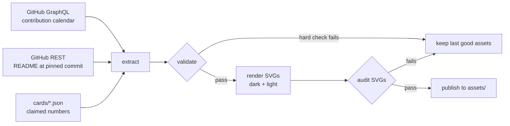

<!--
  Everything in assets/ is generated. Edit cards/*.json or pipeline/*, never the SVGs.
  Rebuilt nightly at 00:00 Dhaka by .github/workflows/profile.yml
-->

<a href="#how-this-profile-works">
  <picture>
    <source media="(prefers-color-scheme: dark)" srcset="assets/hero-dark.svg">
    <source media="(prefers-color-scheme: light)" srcset="assets/hero-light.svg">
    
  </picture>
</a>

I'm a final-year CSE student at AIUB in Dhaka, graduating in June 2027 and looking for data engineering and analytics roles from January 2027. I build data pipelines around Bangladeshi problems, and each project states what its results don't show next to what they do.

### Selected work

<!-- cards:start (generated by pipeline/render_readme.py; edit cards/*.json) -->

  <a href="https://github.com/TahmidShafi/curbstone">
    <picture>
      <source media="(prefers-color-scheme: dark)" srcset="assets/card-curbstone-dark.svg">
      <source media="(prefers-color-scheme: light)" srcset="assets/card-curbstone-light.svg">
      
    </picture>
  </a>
  <a href="https://github.com/TahmidShafi/bari-link">
    <picture>
      <source media="(prefers-color-scheme: dark)" srcset="assets/card-bari-link-dark.svg">
      <source media="(prefers-color-scheme: light)" srcset="assets/card-bari-link-light.svg">
      
    </picture>
  </a>

  <a href="https://github.com/TahmidShafi/dghs-cleanpulse">
    <picture>
      <source media="(prefers-color-scheme: dark)" srcset="assets/card-dghs-cleanpulse-dark.svg">
      <source media="(prefers-color-scheme: light)" srcset="assets/card-dghs-cleanpulse-light.svg">
      
    </picture>
  </a>
  <a href="https://github.com/TahmidShafi/ProtoMacro">
    <picture>
      <source media="(prefers-color-scheme: dark)" srcset="assets/card-protomacro-dark.svg">
      <source media="(prefers-color-scheme: light)" srcset="assets/card-protomacro-light.svg">
      
    </picture>
  </a>

Live demos: [curbstone](https://tahmidshafi.github.io/curbstone/) · [bari-link](https://tahmidshafi.github.io/bari-link/) · [dghs-cleanpulse](https://dghs-cleanpulse.vercel.app) · [ProtoMacro](https://tahmidshafi.github.io/ProtoMacro/)
<!-- cards:end -->

### Signal

<picture>
  <source media="(prefers-color-scheme: dark)" srcset="assets/gauge-dark.svg">
  <source media="(prefers-color-scheme: light)" srcset="assets/gauge-light.svg">
  
</picture>

### How this profile works

This README is a small data pipeline. A scheduled GitHub Action runs every night at 00:00 Dhaka time:

- **Every number on a card is checked.** Each card lists its claims. The pipeline reads the project's README at the current head commit and looks for every claim verbatim. If one is missing, the card shows `stale` and the commit it checked, instead of an outdated number.
- **No orphan numbers.** A number that appears on a card without a backing claim fails validation, and nothing gets published.
- **Write-audit-publish.** SVGs render into a staging folder and are audited (well-formed XML, size limit, no external resources, no NaN) before they replace the live files. A failed run leaves yesterday's profile up.
- **The palette follows the Bangla season.** The pipeline picks colours from the current ritu on the revised Bangladesh calendar: paddy gold in Hemonto, monsoon blues in Borsha, palash red in Boshonto.
- **Standard library only.** Python 3.12 with no dependencies; the unit tests run before every build.

<picture>
  <source media="(prefers-color-scheme: dark)" srcset="assets/manifest-dark.svg">
  <source media="(prefers-color-scheme: light)" srcset="assets/manifest-light.svg">
  
</picture>

<!-- TODO before publishing: add LinkedIn / email / portfolio links here (not filled in to avoid guessing). -->
